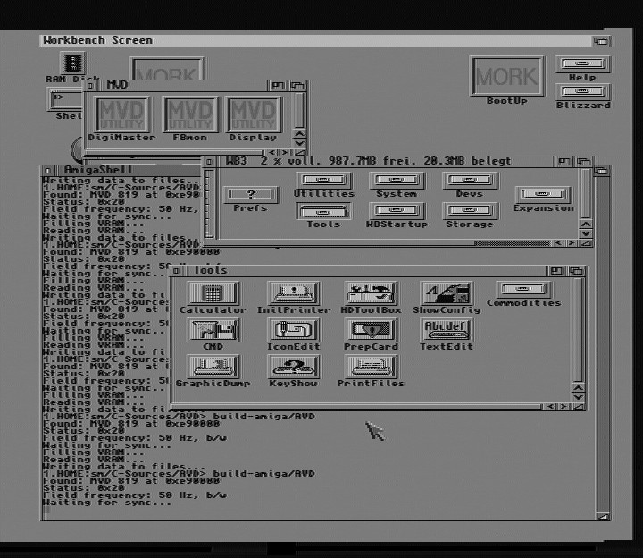

# AVD-Viewer


The AVD-Viewer is no usual image viewer but converts the raw data files from the [AVD project](https://github.com/stmork/avd) into a viewable JPEG.
```
cmake -B build
make -C build
```

The [AVD project](https://github.com/stmork/avd) produces 4:1:1 YUV which is converted into three bytes per pixel. Every group of four Y pixel values share the same U and V data. Note that the SAA 9051 produces only 7 data bits per Y value, so the value is multiplied by two to enhance brightness. The U and V values have color ranges from negative to positive whereas the JPEG lib uses a bias of 128.
